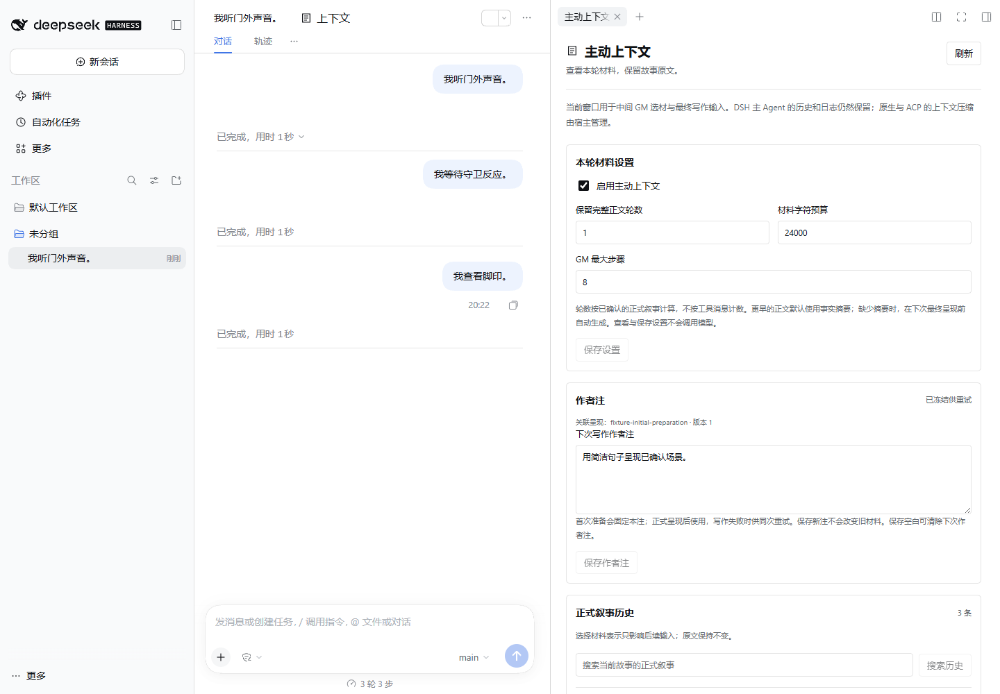
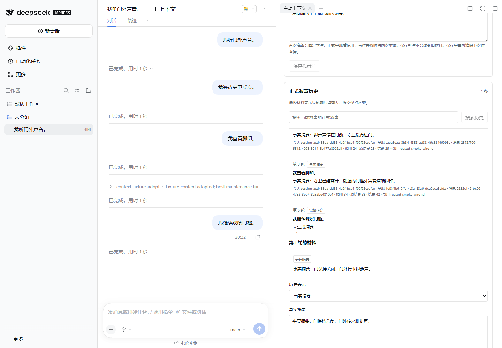

# Context 验收记录

## 同 Snapshot 冷态 preflight 修复 — T9

七包 rev3 在所有 owner 已恢复、尚未激活的 pending 状态重启后，Context preflight 把任何已有 Session row 直接判为冲突。仅修改 preflight：严格验证并比较完整规范化 row，相同状态支持，设置、注、计划、缓存的真实差异仍拒绝。restoreState 的新 job 冲突、journal 身份、严格 proof 与同任务无覆写路径保持。

3 项目标回归先 RED，完整检查通过 68 host +19 UI。新包 SHA256：`3b6fa7b2cae4864a718b4d48216257b2c1f27b52bacb406230e164fe06ce85cd`。实际官方 rc.3 隔离 home 安装当前 Context 与已验收 LS-B d985888 包，公开导入实际 rev3 Snapshot 的两条原日志（73/52 events，inherited 0/49），冷验证后按 LS→Context 恢复。相同状态的 warm 与真实进程重启后 preflight 均支持，冻结作者注双证可读；owner 后改注则冲突，同 job replay 保留改注。模型、writer、历史工具执行均 0。

此证据验证真实 Context/LastStep owner seam，不代表七包激活或完整 SavedStory 恢复通过；协调者需以获批新包替换 manifest 后重验 pending 场景。

## Export maintenance 组合修复 — R24/T17

七包 SavedStory 原生场景发现 Context.exportState 嵌套获取非重入 Agent.runMaintenance。修复仅限 export 协调：不重取宿主锁，保留授权、cold-child ensure、canonical/注来源、原子快照、前后 idle/身份及 source/revision 稳定性；restore 的锁与 proof 没有拆除。

4 项锁回归先 RED 后 GREEN，完整检查为 66 host +19 UI。新包 SHA256：`a1ae06a361099fd2894119e8c87b80e60c73496ed423cfbeb3b4e83b326fb66c`。

只运行一次当前 rc.3 窄范围真实 SDK harness：Context 单独安装，standalone export 和真实外层 runMaintenance 中的同一 export 均成功；维护期间公开 status=idle。显式启动一次本地模型生成后，export 返回 EXPORT_CHANGED；结束生成后再导出成功，owner 设置/注保持。计数为外层 maintenance 1、busy-guard model 1、writer 0、restore 0。没有重复 writer/restore 全链，也没有把此窄测试冒充七包 SavedStory；后者由协调者用新获批 archive 重验。

## C-B 基础包真实联用 checkpoint

实际安装已验收 Database0.2 DB-A、LastStep0.3 LS-A、Context0.2 C-A tgz，在独立官方 rc.3 home 中通过真实插件/SDK 运行。Context 安装包仍为 `486095a318fa273517a27c0f15b2beea7123751cc51dfe80bfc7e368fdcaef4c`，本轮只有测试脚本/fixture/文档和脚本入口变化，没有修改生产逻辑。

- 实际 materialAccess v2 的双来源同 ID、required union、disabled 排除、受保护事实混合批次拒绝、候选外读取通过；真实本地 HTTP embedding/rerank 各 8 次，禁用正文未进入请求，原始 BOM/CRLF 与源哈希不变。
- 实际 LS rp_present→Context.prepare→模块读取/编译→writer→canonical 接受和作者注双证通过。编译前失败释放注；编译后失败保留旧 claim；owner 新版本不被旧 rewriteOf 消费，后续 overlay 不改旧快照，重复 retry 被拒绝。
- 请求累计：main 13、Context prepare 20、summary 1、assemble 8、writer 4；synthetic 工作条目工具 4。canonical 真实 rp_present 调用 6、成功 result 3。有效 retry 的 main dispatch +1、writer +1，prepare/assemble/工作工具不增，不能把 dispatch 说成零调用。
- 当前窗口只影响独立材料：较早正式正文已摘要，但实际 main 输入仍含原文。公开 Session prefix fork 正确读取 Database/Context 因果前缀和 LastStep canonical narratives；进程真实退出/重启后事件前缀相等，没有历史模型/工具重放。实际 owner 材料面板无 pageErrors。

所有执行中的模型均为显式本地 `context-integration-local/main`；receipt 另记录的 migrate 路由没有被调用。主回合额外工具只是明确标识的允许工作条目更新，未安装生产 GM，也不冒充 GM factual receipt。生产采用后的 summary revision、自动 LS composition 继承及完整 saved-story restore 仍等待 GM-B/LS-B 接口包。详见 [运行说明](native-integration.md)。

## C-A fix round 2 — optional owner 控制与 restore 顺序

在 `abfcddf` 上修复复核发现的 owner 控制阻塞，并对齐 R18/R19/T9。最初两项 RED 分别复现缺 LS 的 state 报错，以及 reused restoreId 先查依赖返回错误码；旧歧义数据的 R19 RED 另证实不能因缺服务误置 pending。最终完整检查为 62 host +19 UI。

最终 0.2.0 包 SHA256：`486095a318fa273517a27c0f15b2beea7123751cc51dfe80bfc7e368fdcaef4c`。该包独立 rc.3 native smoke 通过，仍为合成 rp_present、无真实 DB/LS 联用；共享读取/投影变动后的原生采用、摘要、注独占、blocked turn 与同 home 冷重启保持。

定向覆盖：已验证 consumed 在 LS 移除后保留，state/authorNote 可读，新注/reset/关闭 Context 可用，授权、DTO 与陈旧 revision 仍拒绝；新接受和新恢复缺 proof 仍拒绝。内部 finishing 关联只在严格验证后写入，旧多候选账面状态先保留，证明恢复后才缓存；真实 result-only 回退仍 pending。恢复同 ID 改合法 note version/缺失 Session 集合先 ID_CONFLICT，completed replay 不查依赖，两个并发 payload 串行绑定身份。无公共 AuthorNote/status 扩展。

## C-A fix round 1 — transfer 定点修复

在初始 C-A 的 `252115c` 上修复冷 child 导出继承与 consumed restore 双证，并对齐 R15/T5。缺陷及歧义先复现 RED，再通过 focused GREEN；完整检查为 57 host +19 UI。新包 SHA256：`d05ebe89d41a4f055c0ef7dbab6e01feeda423d1a5599f6e116903bea3ce7d6b`。

回归覆盖真实受控 canonical snapshot 边界中的冷 child 设置/未决/pending 注、因果前缀继续回退；无 rp_present 的 consumed 拒绝、Last Step 服务或 receipt 未恢复时原子拒绝、冻结注 id/version/claimId 不匹配拒绝，以及旧审计结果离开 active surface 后 pending 投影。多个匹配 receipt 在接受与恢复时均拒绝；同 restoreId 改 payload/Session 集合统一拒绝 RESTORE_ID_CONFLICT。未新增 DTO 或修改恢复顺序。

因共享 current/capture/fork 路径变化，对这个新包仅复跑一次既有独立 rc.3 native smoke，结果通过，原生采用/摘要/claimed 注、blocked 维护回合和冷重启证据保持。此 smoke 仍使用合成 rp_present、不安装 Database/LastStep；恢复双证属于定点 service 测试，尚未提升为 C-B 真实依赖联用或跨 home 故事恢复证明。下节保留初始包证据。

## 0.2.0 C-A checkpoint — 当前 rc.3

2026-10-25，官方 CLI 实测 `0.2.1-rc.3`，Node `v24.15.0`、pnpm `11.9.0`。最终受测 `dsh-rp-context-0.2.0.tgz` 的 SHA256 为 `63f299d8cba9e542b945aed5b2f8dc7d3fc1f841a23c48bfeafd08ce630bc3b6`。

- `pnpm check`：53 项 host 测试、19 项 UI 测试，lint、构建全部通过；`pnpm package` 通过。
- 最终包独立安装到临时 DSH home，不安装 Database 或 Last Step。明确标识的本地合成 rp_present 经真实 native 工具执行器生成四条叙事；没有真实付费模型推理。
- 实际本地 GM/摘要调用读取规范原文、生成摘要，提交 full/summary/index。作者注在准备前固定，同一 claim 不进入另一次准备。
- 合成 owner action 使用真实维护 turn 的 scoped pre-step 内容替换；native main deriveMessages 与 Context 均读取已采用文本，旧 revision 摘要失效，随后产生新实际摘要。采用不增加模型或呈现次数，宿主维护 turn 仍如实为 blocked。
- 同一临时 home 的实际宿主进程退出、重新启动后，完整事件前缀结构相等；冷读 Context 保留已采用文本，新进程模型与历史呈现计数均为 0。
- sidebar、全屏、520px 窄屏、关闭重开通过，pageErrors 为空。窄屏 documentWidth=520，没有水平溢出。
- v2 同裸 ID 不碰撞、受保护事实混合批次拒绝、作者注接受 proof/分支投影、精确材料与迟到响应、transfer 的来源/原子/幂等/冲突由 focused RED→GREEN 和单元/UI 测试证明。




此 checkpoint 的原生 rp_present 是合成 fixture，不能冒称真实 Last Step writer、Database v2 联用或完整跨 home 存档恢复已经通过。transfer seam 已实现并测试，但整套恢复仍须由 Story Kit 导入真实 canonical logs 并联用所有状态所有者。真实 Database0.2/LastStep0.3 组合、原生材料快照和作者注 writer 重试，留待 C-B 依赖就绪后验收。以下 rc.2 组合记录只属于旧 0.1.0。

## 0.1.0 历史组合记录 — rc.2

2026-10-25，官方 DSH 0.2.1-rc.2，Node24、pnpm11.9，独立临时 DSH home。提供方、embedding、rerank、GM、摘要与 writer 全部是明确标识的本地确定性 fixture，没有真实付费推理或用户角色卡。

## 覆盖

- 各新插件可只安装自己的 tgz，原生入口、侧栏、全屏、520px、关闭重开均通过；独立上下文验收不要求数据库或最后一步包。
- 组合安装数据库、上下文、最后一步0.2和 Loop0.1。主 Agent 调用事实工具，GM 用不同模型准备材料，文风组装和 writer 使用独立实际路由。
- 初始20个候选没有目标条目，GM 主动搜索完整启用库并读取候选外目标。真实本地 HTTP embedding/rerank 接口收到请求，禁用哨兵不在其输入中。
- GM 试图改写只读必开条目被拒绝，之后合法修改、新建和临时备注进入会话覆盖。源数据库的 BOM、CRLF 和原始文本保持不变。
- 正文默认窗口设为1：早期正文生成实际事实摘要，GM 按规范来源展开原文，并在后续改为索引。未决事项独立保留。
- 四轮成功叙事后，第五轮 writer 人为失败。数据库的已提交变化保持，失败稿不进入正式历史；仅重试 writer 后累计5次事实工具、6次 writer，GM/组装不重复执行。
- 在第二轮结束事件处分叉，子会话只继承第2次数据库变化和2条叙事，父会话的后续变化不进入子分支。随后用宿主合法 surface replacement 回退第五轮和重试，打开的数据库视图自动恢复到第4次变化，旧失败来源不再可重试。宿主重启后资料与4条有效叙事恢复。
- 完整来源关联包含 assistant message ID、sourceEventSeqs 与工具事件序号；提供方复用工具调用 ID 不串回合。
- Astra 最终审查发现的失效来源重试、成功重试重复和数据库视图失效通知已修复，并通过定向回归与复核。

单元测试合计229项：数据库43运行时＋14界面，上下文36运行时＋17界面，最后一步98运行时＋21界面。三个项目的 lint 和生产构建通过。

## 复验

每个仓库执行 pnpm check、pnpm package、pnpm smoke。组合在最后一步仓库运行：

```powershell
$env:DSH_DATABASE_TGZ = (Resolve-Path ../downloads/dsh-rp-database-0.1.0.tgz).Path
$env:DSH_CONTEXT_TGZ = (Resolve-Path ../downloads/dsh-rp-context-0.1.0.tgz).Path
$env:DSH_LOOP_TGZ = (Resolve-Path ../downloads/dsh-loop-studio-0.1.0.tgz).Path
node scripts/fullstack-smoke.mjs
```

改为实际下载路径。需要官方启动器与 Playwright Chromium，可用 DSH_BIN 和 PLAYWRIGHT_CHROMIUM_EXECUTABLE_PATH 指定。结果 .runtime/fullstack-evidence/acceptance.json 保存受测安装包哈希，截图在同目录。Release 附 SHA256SUMS 对应正式安装包。

## 范围

上下文窗口作用于中间 GM 与最终正文，不篡改宿主主循环的冻结请求；主循环全局压缩仍由 DSH／经过对应版本验证的 ACP 管理。没有执行历史 DV fork 或上游脚本，也没有把它们当作依赖。

这是工程调用与生命周期验收，不能代替20—30轮真实模型的文学质量、角色一致性或大库检索效果评测。当前表示以正式叙事回合为单位，未宣称实现无限层级章节压缩。embedding 在检索时按有效内容计算，未验证持久向量索引性能。人物知情依靠叙事备注与 GM 判断，不是程序保密证明。
