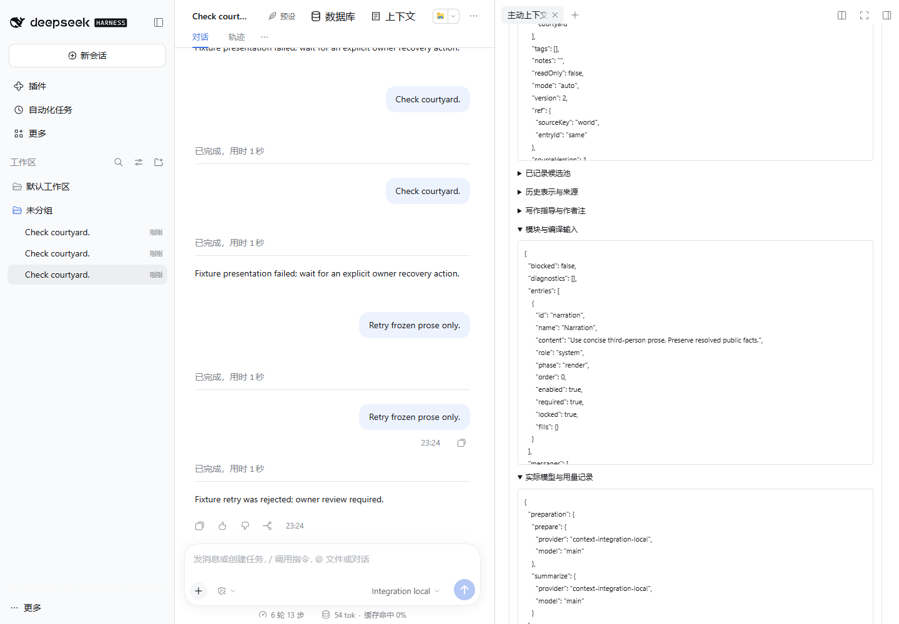
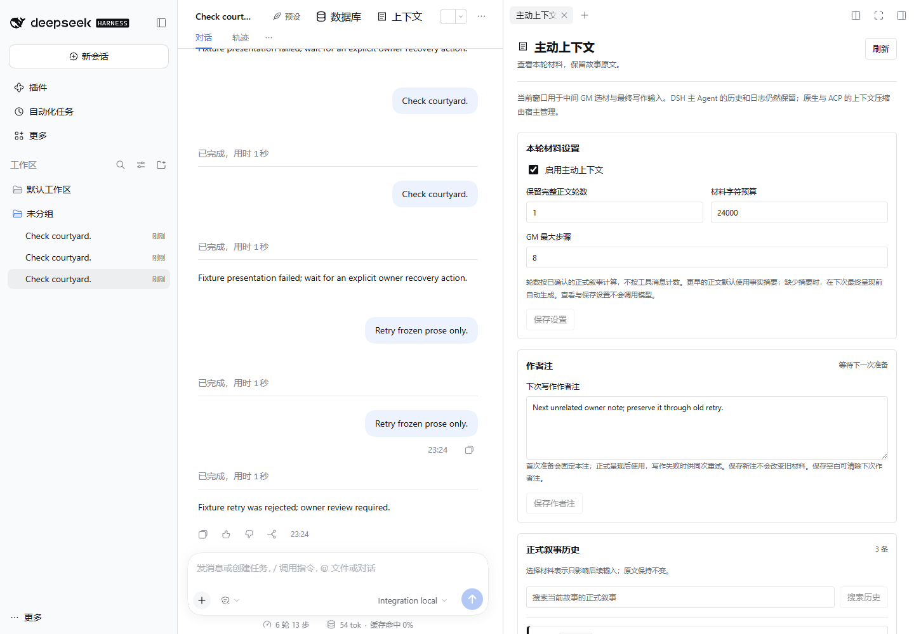

# 真实基础插件联用

`scripts/integration-smoke.mjs` 将明确指定的 Database、Context、LastStep tgz 安装到新建的临时 DSH home，经当前官方 rc.3 原生宿主和 SDK 运行。不会导入兄弟仓源码、写生产 profile 或调用付费模型。

```powershell
node scripts/integration-smoke.mjs `
  --database-tgz ./downloads/dsh-rp-database-0.2.0.tgz `
  --last-step-tgz ./downloads/dsh-rp-last-step-0.3.0.tgz `
  --context-tgz ./artifacts/dsh-rp-context-0.2.0.tgz
```

也可设置 DSH_DATABASE_TGZ、DSH_LAST_STEP_TGZ、DSH_CONTEXT_TGZ 后运行 `pnpm smoke:integration`。可选 DSH_BIN、PLAYWRIGHT_CHROMIUM_EXECUTABLE_PATH 指定本机启动器/现有 Chromium；`--evidence-dir` 指定证据目录，默认 `.runtime/integration-evidence`。每次记录真实包路径和 SHA256，不根据相邻源码猜测版本。

这组测试使用真实 Database materialAccess、Context.prepare、LastStep 原生 rp_present、模块编译、writer、canonical 接受、owner material/narratives。唯一额外主回合工具明确标识为 synthetic working-entry update，不是生产 GM；场景文本、模型和 HTTP embedding/rerank 返回均为合成、确定性数据。实际 native 工具与服务执行没有被替换。

覆盖多来源同裸 ID、required union、禁用正文不进入检索/模型、受保护事实混合批次拒绝、候选外检索、BOM/CRLF 原件保留；编译前失败释放作者注、编译后失败保留 claim、真实 rewriteOf 只重做 writer 阶段、替换 owner 注不被旧 retry 消费、重复 retry 拒绝。记录 main 调度与独立阶段次数，不能把额外的 main dispatch 说成零调用。

Context 窗口只影响自己的材料与 writer；测试核对较早正文已摘要，但仍保留在真实主模型输入。实际 Session prefix fork 检查 Database/Context 的因果状态、LastStep canonical narratives 读取；owner 材料面板读取真正冻结的条目/版本、模块和模型。实际进程退出/重启后，对照 canonical event 前缀并检查没有历史模型/工具重放。

此基础检查点没有运行生产 GM 回执路线，也没有用 fixture helper 代替生产稿件采用。生产 adoptDispatch、自动 LastStep composition 继承和完整 saved-story restore 等最终 seam，等待相应已验收包再补。它不是完整 GM/StoryKit/Studio 联用或真实模型叙事质量验收。



